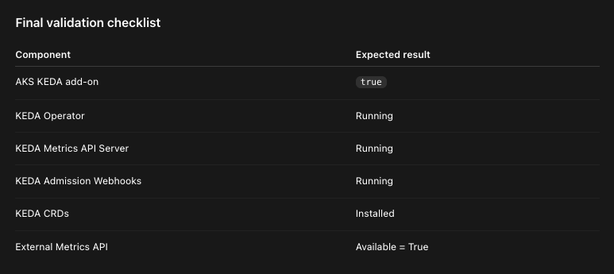
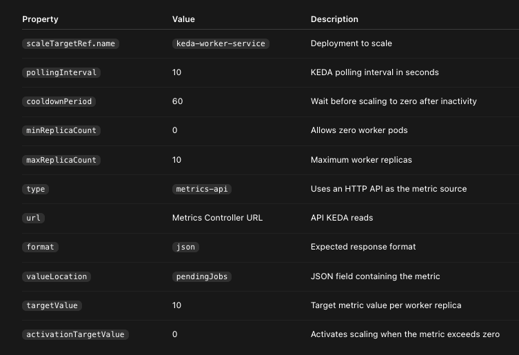

To import all the vars from .env 
# Phase 1 — Azure Infrastructure
## Login To Azure
```shell
az login
```

## To import all the vars from .env 
```shell
cd 09.aks-workload-identity/storage-account-connect
source ./.env
```

## Check all ENV vars 
```shell
echo SUBSCRIPTION_ID = $SUBSCRIPTION_ID
echo RESOURCE_GROUP = $RESOURCE_GROUP
echo LOCATION = $LOCATION
echo AKS_CLUSTER_NAME = $AKS_CLUSTER_NAME
```

## Create AKS
```shell
az aks create \
  --subscription $SUBSCRIPTION_ID \
  --resource-group $RESOURCE_GROUP \
  --name $AKS_CLUSTER_NAME \
  --location $LOCATION \
  --node-count 1 \
  --node-vm-size Standard_B4ms \
  --enable-oidc-issuer \
  --enable-workload-identity \
  --enable-keda \
  --generate-ssh-keys
```

## Get the cluster Credentials
```shell
az aks get-credentials --resource-group $RESOURCE_GROUP --name $AKS_CLUSTER_NAME
```

## Verify KEDA is enabled in AKS
```shell
az aks show \
  --subscription $SUBSCRIPTION_ID \
  --resource-group $RESOURCE_GROUP \
  --name $AKS_CLUSTER_NAME \
  --query "workloadAutoScalerProfile.keda.enabled" \
  -o tsv
```

## Verify KEDA pods are running
```shell
kubectl get deployments -n kube-system | grep keda
```
Output:-
```
keda-admission-webhooks           1/1   1   1
keda-operator                     1/1   1   1
keda-operator-metrics-apiserver   1/1   1   1
```

## Verify KEDA CRDs
```shell
kubectl get crds | grep keda
```
Output:-
```
scaledobjects.keda.sh
scaledjobs.keda.sh
triggerauthentications.keda.sh
clustertriggerauthentications.keda.sh
```
These CRDs allow Kubernetes to understand KEDA-specific resources such as ScaledObject.

## Verify KEDA Metrics API registration
```shell
kubectl get apiservice v1beta1.external.metrics.k8s.io
```
Output:-
```
NAME                              SERVICE AVAILABLE AGE
v1beta1.external.metrics.k8s.io   True    5m
```




## Create ACR
```
az acr create \
  --subscription $SUBSCRIPTION_ID \
  --resource-group $RESOURCE_GROUP \
  --name $ACR_NAME \
  --location $LOCATION \
  --sku Basic \
  --admin-enabled false
```

# Verify ACR Creation
```shell
az acr show \
  --subscription $SUBSCRIPTION_ID \
  --resource-group $RESOURCE_GROUP \
  --name $ACR_NAME \
  --query "{Name:name,LoginServer:loginServer,SKU:sku.name}" \
  -o table
```

## Attach ACR to AKS
```shell
az aks update \
  --subscription $SUBSCRIPTION_ID \
  --resource-group $RESOURCE_GROUP \
  --name $AKS_CLUSTER_NAME \
  --attach-acr $ACR_NAME
```

## Verify AKS–ACR integration
```shell
az aks check-acr \
  --subscription $SUBSCRIPTION_ID \
  --resource-group $RESOURCE_GROUP \
  --name $AKS_CLUSTER_NAME \
  --acr "${ACR_NAME}.azurecr.io"
```


# Phase 2 — Build Node.js Applications

```markdown
| Microservice | Recommended Name | Purpose |
|---|---|---|
| **Microservice 1** | `keda-metrics-controller` | Exposes custom metrics and allows updating metric values through REST APIs. |
| **Microservice 2** | `keda-worker-service` | Demonstrates automatic pod scaling from 0 to 10 replicas. |
```

## clone the keda-metrics-controller
 - Exposes custom metrics and allows updating metric values through REST APIs.
```
https://github.com/Casa-Cloud/keda-metrics-controller

git clone git@github.com:Casa-Cloud/keda-metrics-controller.git
```

## Build and push to ACR - keda-metrics-controller
 - az acr build performs both operations automatically: Build + Push to Azure Container Registry.

```
 az acr build \
  --subscription $SUBSCRIPTION_ID \
  --registry $ACR_NAME \
  --image keda-metrics-controller:v1 \
  --file Dockerfile \
  .
```


## Clone keda-worker-service
```
https://github.com/Casa-Cloud/keda-worker-service
git clone https://github.com/Casa-Cloud/keda-worker-service.git

```
## Build and push to ACR - keda-worker-service
 - az acr build performs both operations automatically: Build + Push to Azure Container Registry.

```shell
az acr build \
  --subscription $SUBSCRIPTION_ID \
  --registry $ACR_NAME \
  --image keda-worker-service:v1 \
  --file Dockerfile \
  .
```

# Phase 3 — Kubernetes Deployments

Create the Kubernetes Deployment and Service manifests for keda-metrics-controller and keda-worker-service.

## Create Kubernetes namespace
```shell
kubectl create namespace $NAMESPACE
```

## Create Deployment - keda-metrics-controller
```yaml
kubectl apply -f - <<EOF
apiVersion: apps/v1
kind: Deployment
metadata:
  name: keda-metrics-controller
  namespace: ${NAMESPACE}
  labels:
    app: keda-metrics-controller
spec:
  replicas: 1
  selector:
    matchLabels:
      app: keda-metrics-controller
  template:
    metadata:
      labels:
        app: keda-metrics-controller
    spec:
      containers:
        - name: keda-metrics-controller
          image: ${ACR_LOGIN_SERVER}/keda-metrics-controller:${IMAGE_TAG}
          imagePullPolicy: IfNotPresent
          ports:
            - name: http
              containerPort: 9001
              protocol: TCP
          env:
            - name: NODE_ENV
              value: "production"
            - name: PORT
              value: "9001"
          resources:
            requests:
              cpu: "100m"
              memory: "128Mi"
            limits:
              cpu: "500m"
              memory: "512Mi"
          readinessProbe:
            httpGet:
              path: /api/metrics
              port: 9001
            initialDelaySeconds: 5
            periodSeconds: 10
          livenessProbe:
            httpGet:
              path: /api/metrics
              port: 9001
            initialDelaySeconds: 10
            periodSeconds: 20
EOF
```

## Create Cluster IP Service - keda-metrics-controller

```shell
kubectl apply -f - <<EOF
apiVersion: v1
kind: Service
metadata:
  name: keda-metrics-controller
  namespace: ${NAMESPACE}
  labels:
    app: keda-metrics-controller
spec:
  type: ClusterIP
  selector:
    app: keda-metrics-controller
  ports:
    - name: http
      port: 9001
      targetPort: 9001
      protocol: TCP
EOF

```

## Verify Deployment
```shell
kubectl get deployments -n $NAMESPACE
kubectl get svc -n $NAMESPACE
kubectl rollout status \
  deployment/keda-metrics-controller \
  -n $NAMESPACE \
  --timeout=120s
```

## Test Metrics API Using Port Forwarding
```shell
kubectl port-forward \
  -n $NAMESPACE \
  svc/keda-metrics-controller \
  9001:9001
```

## Call API in anoter terminal
```shell
curl http://localhost:9001/api/metrics
```

## Update value 
```shell
curl -X POST \
  http://localhost:9001/api/metrics \
  -H "Content-Type: application/json" \
  -d '{"pendingJobs":50}'
```

## Verify Kubernetes Service Connectivity
KEDA will access your API through the internal Kubernetes DNS name.

```shell
http://keda-metrics-controller.keda-demo.svc.cluster.local:9001/api/metrics
```
You can validate DNS resolution and HTTP connectivity from inside the cluster:

## Test service from withing cluster
```shell
kubectl run curl-test \
  --namespace=$NAMESPACE \
  --rm -i \
  --restart=Never \
  --image=curlimages/curl \
  -- \
  curl -fsS \
  http://keda-metrics-controller:9001/api/metrics
```

You could also use the fully qualified Kubernetes DNS name:
```
http://keda-metrics-controller.keda-demo.svc.cluster.local:9001/api/metrics
```

## Create Kubernetes Deployment - keda-worker-service

```bash
kubectl apply -f - <<EOF
apiVersion: apps/v1
kind: Deployment
metadata:
  name: keda-worker-service
  namespace: ${NAMESPACE}
  labels:
    app: keda-worker-service
spec:
  replicas: 1
  selector:
    matchLabels:
      app: keda-worker-service
  template:
    metadata:
      labels:
        app: keda-worker-service
    spec:
      containers:
        - name: keda-worker-service
          image: ${ACR_LOGIN_SERVER}/keda-worker-service:${IMAGE_TAG}
          imagePullPolicy: IfNotPresent
          ports:
            - name: http
              containerPort: 9001
              protocol: TCP
          env:
            - name: NODE_ENV
              value: "production"
            - name: PORT
              value: "9001"
            - name: POD_NAME
              valueFrom:
                fieldRef:
                  fieldPath: metadata.name
            - name: POD_NAMESPACE
              valueFrom:
                fieldRef:
                  fieldPath: metadata.namespace
          resources:
            requests:
              cpu: "100m"
              memory: "128Mi"
            limits:
              cpu: "500m"
              memory: "512Mi"
          readinessProbe:
            httpGet:
              path: /health
              port: 9001
            initialDelaySeconds: 5
            periodSeconds: 10
          livenessProbe:
            httpGet:
              path: /health
              port: 9001
            initialDelaySeconds: 10
            periodSeconds: 20
EOF
```

## Create ClusterIP Service
```bash
kubectl apply -f - <<EOF
apiVersion: v1
kind: Service
metadata:
  name: keda-worker-service
  namespace: ${NAMESPACE}
  labels:
    app: keda-worker-service
spec:
  type: ClusterIP
  selector:
    app: keda-worker-service
  ports:
    - name: http
      protocol: TCP
      port: 9001
      targetPort: 9001
EOF
```

Internal Kubernetes URL:
```
http://keda-worker-service.keda-demo.svc.cluster.local:9001
```

## Verify serivce 
```shell
kubectl get deployments -n $NAMESPACE
kubectl get svc -n $NAMESPACE
kubectl rollout status \
  deployment/keda-worker-service \
  -n $NAMESPACE \
  --timeout=120s
```

## Test service from withing cluster
```shell
kubectl run curl-test \
  --namespace=$NAMESPACE \
  --rm -i \
  --restart=Never \
  --image=curlimages/curl \
  -- \
  curl -fsS \
  http://keda-worker-service.keda-demo.svc.cluster.local:9001/health
```

# Phase 4 — KEDA Configuration

We'll complete this in four steps:
1. Verify the Metrics Controller API.
2. Create the KEDA ScaledObject.
3. Verify KEDA and the generated HPA.
4. Test scaling from 0 to 10 replicas and back to 0.

## Verify Metrics Controller API
```shell
kubectl run curl-test \
  --namespace=$NAMESPACE \
  --rm -i \
  --restart=Never \
  --image=curlimages/curl \
  -- \
  curl -fsS \
  http://keda-metrics-controller:9001/api/metrics
```
## Create KEDA ScaledObject
```bash
kubectl apply -f - <<EOF
apiVersion: keda.sh/v1alpha1
kind: ScaledObject
metadata:
  name: keda-worker-scaler
  namespace: ${NAMESPACE}
  labels:
    app: keda-worker-service
spec:
  scaleTargetRef:
    name: keda-worker-service

  pollingInterval: 10
  cooldownPeriod: 60

  minReplicaCount: 0
  maxReplicaCount: 10

  triggers:
    - type: metrics-api
      metadata:
        url: "http://keda-metrics-controller.${NAMESPACE}.svc.cluster.local:9001/api/metrics"
        format: "json"
        valueLocation: "pendingJobs"
        targetValue: "10"
        activationTargetValue: "0"
EOF
```




- KEDA provides the metric to Kubernetes HPA.

The target calculation is:

```
Desired replicas ≈ Current metric / Target targetValue

Desired replicas ≈ 50 / 10

Desired replicas ≈ 5
```

## Verify KEDA ScaledObject
```shell
kubectl get scaledobject -n $NAMESPACE
```

Output:-
```
NAME                 SCALETARGETKIND      SCALETARGETNAME      MIN   MAX   TRIGGERS      READY
keda-worker-scaler   apps/v1.Deployment   keda-worker-service  0     10    metrics-api   True
```
## Describe ScaledObject
```shell
kubectl describe scaledobject \
  keda-worker-scaler \
  -n $NAMESPACE
```

Check the conditions:
```shell
Ready: True
Active: False
```

 - Ready=True means the ScaledObject is configured successfully.
 - Active=False is expected when the metric is zero.

## Verify generated HPA
```shell
kubectl get hpa -n $NAMESPACE
```
output:-
```
keda-hpa-keda-worker-scaler
```

Example Output:-

```
NAME                          REFERENCE                      TARGETS   MINPODS   MAXPODS
keda-hpa-keda-worker-scaler   Deployment/keda-worker-service  0/10      1         10
```

> Important: The generated HPA may show MINPODS=1, even though your ScaledObject specifies minReplicaCount: 0.

> This is normal. KEDA manages the transition between zero and one replica separately.

## Verify worker replicas
```shell
kubectl get deployment \
  keda-worker-service \
  -n $NAMESPACE
```

```
NAME                  READY   UP-TO-DATE   AVAILABLE
keda-worker-service   0/0     0            0
```


# Phase 5 — Live Autoscaling Demonstration

## Start monitoring pods - terminal 1
```shell
kubectl get pods \
  -n $NAMESPACE \
  -l app=keda-worker-service \
  -w
```

## Monitor HPA - in terminal 2
```shell
kubectl get hpa \
  -n $NAMESPACE \
  -w
```

## Port-forward the Metrics Controller - terminal 3

```shell
kubectl port-forward \
  -n $NAMESPACE \
  svc/keda-metrics-controller \
  9001:9001
```

# Increase metric value to 50

```shell
curl -X POST \
  http://localhost:9001/api/metrics \
  -H "Content-Type: application/json" \
  -d '{"pendingJobs":50}'
```

## Verify value 
```shell
curl http://localhost:9001/api/metrics
```

## Scale down to zero
```shell
curl -X POST \
  http://localhost:9001/api/metrics \
  -H "Content-Type: application/json" \
  -d '{"pendingJobs":0}'
```

- KEDA eventually scales the worker Deployment down to zero.


## Final architecture 

```
                USER
                 |
                 | POST /api/metrics
                 | {"pendingJobs": 50}
                 v
      +---------------------------+
      | keda-metrics-controller   |
      |                           |
      | Replicas: 1               |
      | Port: 9001                |
      +---------------------------+
                 |
                 | GET /api/metrics
                 v
      +---------------------------+
      | KEDA Metrics API Scaler   |
      |                           |
      | pollingInterval: 10       |
      | targetValue: 10           |
      +---------------------------+
                 |
                 | External metric
                 v
      +---------------------------+
      | Kubernetes HPA            |
      |                           |
      | Calculates replicas       |
      +---------------------------+
                 |
                 v
      +---------------------------+
      | keda-worker-service       |
      |                           |
      | Pod 1                     |
      | Pod 2                     |
      | Pod 3                     |
      | Pod 4                     |
      | Pod 5                     |
      +---------------------------+
                USER
                 |
                 | POST /api/metrics
                 | {"pendingJobs": 50}
                 v
      +---------------------------+
      | keda-metrics-controller   |
      |                           |
      | Replicas: 1               |
      | Port: 9001                |
      +---------------------------+
                 |
                 | GET /api/metrics
                 v
      +---------------------------+
      | KEDA Metrics API Scaler   |
      |                           |
      | pollingInterval: 10       |
      | targetValue: 10           |
      +---------------------------+
                 |
                 | External metric
                 v
      +---------------------------+
      | Kubernetes HPA            |
      |                           |
      | Calculates replicas       |
      +---------------------------+
                 |
                 v
      +---------------------------+
      | keda-worker-service       |
      |                           |
      | Pod 1                     |
      | Pod 2                     |
      | Pod 3                     |
      | Pod 4                     |
      | Pod 5                     |
      +---------------------------+

```